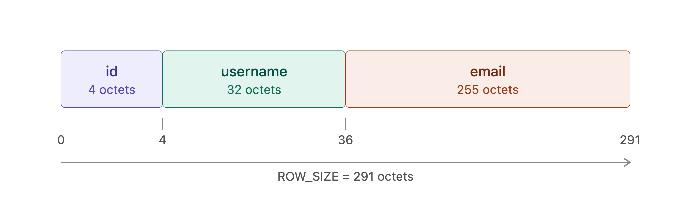

# Architecture

We’re going to start small by putting a lot of limitations on our database. For now, it will:

- Support two operations: inserting a row and printing all rows
- Reside only in-memory 
- Support a single, hard-coded table

Our hard-coded table will look like this.

column <-> type
id <-> integer
username <-> varchar(32)
email <-> varchar(255)

Insert statements are going to look like this.

`insert 1 cstack foo@bar.com`

Now we need to copy that data into some data structure representing the table. We'll start with something simple. Arrays. Like a B-tree, it will group rows into pages, but instead of arranging those pages as a tree it will arrange them as an array.

Here’s my plan:

Store rows in blocks of memory called pages
Each page stores as many rows as it can fit
Rows are serialized into a compact representation with each page
Pages are only allocated as needed
Keep a fixed-size array of pointers to pages

## Rows



Each string column keeps one extra byte for its null terminator, so `username` is `char[33]` and `email` is `char[256]`.

| column   | C type     | size (bytes) | offset | range     |
|----------|------------|--------------|--------|-----------|
| id       | `uint32_t` | 4            | 0      | 0–3       |
| username | `char[33]` | 33           | 4      | 4–36      |
| email    | `char[256]`| 256          | 37     | 37–292    |
| total    |            | 293          |        |           |

`serialize_row` packs these fields back to back, so a serialized row is `ROW_SIZE = 293` bytes. The in-memory `Row` struct is 296 bytes: the compiler adds 3 bytes of padding at the end to keep its size a multiple of 4 (the alignment of `uint32_t`). Those 3 bytes are never copied into a page.

Bytes after a string's null terminator are copied as they are: `serialize_row` always copies the full 33 and 256 bytes, so whatever was left in the `Statement` on the stack ends up in the page.

## Pages

| constant        | value | how                          |
|-----------------|-------|------------------------------|
| `PAGE_SIZE`     | 4096  | 4 KB, the usual OS page size |
| `ROWS_PER_PAGE` | 13    | 4096 / 293 (integer division)|
| used per page   | 3809  | 13 × 293                     |
| unused per page | 287   | 4096 − 3809 (7 % of the page)|

Rows never straddle two pages. A row is found with:

```c
page_num    = row_num / ROWS_PER_PAGE;   // which page
row_offset  = row_num % ROWS_PER_PAGE;   // which slot in that page
byte_offset = row_offset * ROW_SIZE;     // where the slot starts
```

For example row 27 lives in page 2, slot 1, at bytes 293–585 of that page.

## Table

| constant / struct | value      | notes                                   |
|-------------------|------------|-----------------------------------------|
| `TABLE_MAX_PAGES` | 100        |                                         |
| `TABLE_MAX_ROWS`  | 1300       | 13 × 100                                |
| `sizeof(Table)`   | 808 bytes  | `num_rows` (4) + 4 padding + 100 × 8-byte pointers |
| pages, when full  | 409 600 bytes | 100 × 4096                           |

Pages are allocated with `malloc` the first time a row lands in them, so the table only uses `ceil(num_rows / 13)` pages. Inserting row 1301 returns `EXECUTE_TABLE_FULL`.

## Other structs

| struct        | size (bytes) | layout                                                  |
|---------------|--------------|---------------------------------------------------------|
| `Statement`   | 300          | `type` (4) + `Row` (296)                                |
| `InputBuffer` | 24           | `buffer` pointer (8) + `buffer_length` (8) + `input_length` (8) |

Sizes measured on 64-bit macOS (arm64) with `sizeof` and `offsetof`.
